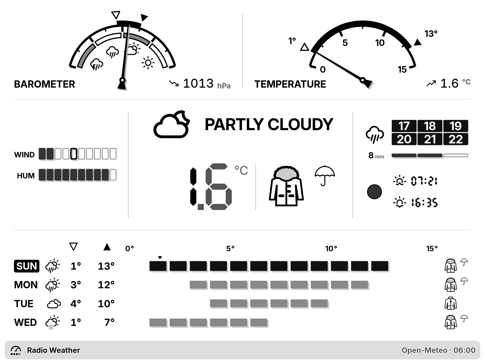

# trmnl-radio-weather-plugin

## Radio Weather



The weather as a calm early-80s hi-fi receiver, for [TRMNL](https://trmnl.com) e-paper displays:

- **Dials** (TRMNL X): a barometer with the pressure trend, and a temperature dial with today's low and high.
- **Console**: the temperature in segment digits with what to wear (clothing, umbrella, sunglasses); block meters for wind and gusts, UV, air quality, humidity, pollen and pressure when they matter, grey cells for what is still to come today.
- **Rain or sun**: an hour calendar when rain is coming; otherwise sunrise, sunset and the moon as it looks from your location.
- **Bottom strip**: the coming days or hours.
- **Indoor sensor**: with a TRMNL temperature sensor on the screen, indoor becomes the big reading and outdoor moves beside it, or show another TRMNL's sensor (a hallway upstairs) with outside as the big reading. Readings older than 3 hours are ignored.

Every view (full, half horizontal, half vertical, quadrant), 1-bit, greyscale and colour screens, dark mode, 24 or 12 hour time. When Open-Meteo is slow or down, the last saved forecast shows with its time.

### Settings

| Setting | What it does |
|---|---|
| Location | City, postal code or latitude,longitude |
| Temperature unit | Celsius or Fahrenheit |
| Time format | 24 hours (17:00) or 12 hours (5:00 PM) |
| Bottom strip | Days, hours, or hours with days after 18:00 |
| Hide title bar | Hides the title bar on the full view |
| Sensor | Shows the readings of a TRMNL sensor: this screen's own, or the TRMNL set below. Hide: outside weather only. |
| Sensor from another TRMNL | Optional device number (the digits in the address of its page on trmnl.com). Empty: this screen's own sensor. |
| Sensor label | Optional short name, for example Upstairs, shown beside the house icon and on the temperature dial. Empty: the icon alone. |
| Main reading | Which reading comes first, in black: Automatic (the sensor when it is this screen's own, outside when it comes from another TRMNL), Sensor, or Outside. The other one follows in grey, its meters after. Both temperatures are the same size. |
| CO2 meter | Shows the CO2 meter when the sensor measures CO2. |

Data comes from [Open-Meteo](https://open-meteo.com); no key is needed.

## Development

Built with [trmnlp](https://github.com/usetrmnl/trmnlp).

```bash
cd plugin
trmnlp serve        # preview
trmnlp test         # RSpec specs in plugin/tests
node ../test/model/run.js   # pure-logic tests of the weather model
(cd .. && npm install && node tools/build.js)   # after editing source/shared.liquid
ruby ../tools/sync_trmnl_i18n.rb   # re-sync TRMNL's translations
```

## Editing

Edit `source/shared.liquid` (all comments live there), then run `node tools/build.js`: it writes `plugin/src/shared.liquid` (Liquid comments stripped, long Liquid variable names shortened, page script minified), which is what trmnlp pushes. Never edit the built file; the model tests fail when it is out of date or over 84 KB.

Two render-check tiers, same spec (`tools/render_check_spec.rb`), run base first, then devices, then ship:

| Tier | Cases | Run |
|---|---|---|
| Base | `tools/render_check_cases.json` (OG, X, colour OG; scope unchanged) | `cd plugin && SW_CASES="$(cat ../tools/render_check_cases.json)" SW_OUT=<dir> trmnlp test ../tools/render_check_spec.rb` |
| Devices | `tools/render_check_devices.json`: every TRMNL model x full/hh/hv/quadrant, portrait full+hv, one dark, full and portrait full with an indoor sensor | `tools/check_devices.sh [out_dir] [model-substring]` prints a pass/fail table per device (about 35 min for all, one browser) |

Regenerate the device file after TRMNL adds a model: `python3 tools/make_device_cases.py` (reads trmnl.com/api/models). Playdate is left out until the owner decides on small screens.

## Try-it site (GitHub Pages, from main /docs)

The real transform and markup run in the page (LiquidJS), inside TRMNL's `trmnl-frame`. Regenerate: `tools/site/build.sh` (writes `docs/`; `--check` fails when stale, also run by the model tests). Guard: `tools/site/check_fidelity.sh` compares the page's markup with trmnlp's Ruby Liquid for 12 cases (no browser). `node tools/site/smoke.cjs` loads every example x device x view in Chromium and Firefox and fails on a crash, a page error or an empty part (needs Playwright, see the file header; about 12 minutes; `--quick` for a few).

## Open items

| Item | Detail |
|---|---|
| Palma hh CONDRATIO | Passes at 1.147 against the 1.15 limit (B19 re-measured; the old 1.2 and the full-sens 1.31 no longer show: full-sens has no sibling in its group). Margin is 0.003: a change to the md portrait half horizontal digits or `swOGPortrait` can tip it. |
| Device tier, own-sensor cases | 4 of the 117 `-sens` cases are red at 3a230e7, all on models with no framework CSS rules under trmnlp (the harness gap, see `tools/check_devices.sh` KNOWN): `kobo_clara_2e__full-sens` (digit height 22.4), `kobo_libra_color__full-port-sens`, `onyx_boox_go_10_3_lumi__full-port-sens`, `tcl_nxtpaper_14__full-port-sens` (row 2 icon meets low, gap 1 px). The avalue_epd_42s, generic_16_9 and palma `-sens` cases are green. |

## Licence

MIT, see [LICENSE](LICENSE). Copyright (c) 2026 ExcuseMi.

The weather texts (the `sw_i18n` capture in each `plugin/src/<view>.liquid`, the slots between the `I18N_TRMNL` markers in `shared.liquid`) come from
[usetrmnl/trmnl-i18n](https://github.com/usetrmnl/trmnl-i18n) and stay under its MIT licence; see
[third_party/trmnl-i18n-LICENSE](third_party/trmnl-i18n-LICENSE). The weather icons are loaded from trmnl.com and are not part of this repository.
